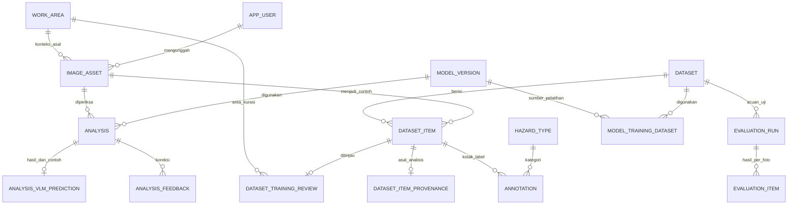

# Pembaruan ADS dan pembelajaran foto rig

Tanggal: 10 Oktober 2026.

## Aplikasi yang diperbarui

Proyek: `C:\Users\Victus\Documents\Codex\2026-10-02\dar\outputs\sistem-inspeksi-k3`.

Aplikasi ini memiliki dataset **Rig Protect - calon pelatihan**, versi `pdf-20261007-1`. Pada awal pekerjaan ada 536 foto: 535 DRAFT dan 1 VERIFIED. Pengembangan dilakukan pada aplikasi ini karena sesuai dengan tangkapan layar pengguna. Prototipe FastAPI terpisah tidak menjadi aplikasi utama.

## 1. Lingkup area kerja

Katalog diambil dari judul bagian pemeriksaan yang tersimpan dalam konteks lima PDF CRSSC tanggal 5 Oktober 2026: AU-15, BDSI-19, BMS-05, BMS-20, dan GW-363.

Ada **42 bagian pemeriksaan rig + Ruangan Kantor**. Bagian tersebut mencakup area, peralatan, dan kegiatan/dokumen sebagaimana pembagian laporan; PDF tidak menyediakan daftar lokasi fisik yang terpisah. Identitas rig tetap disimpan sebagai asal dokumen atau kelompok pengambilan, terpisah dari pilihan peralatan.

Istilah `Draw Work` dan `Drawwork` digabung menjadi **Drawwork**. Salah tulis yang jelas seperti `Working Platorm` ditampilkan sebagai **Working Platform**. Istilah sumber dipertahankan di `work-area-catalog.json`. Istilah `Matng Board` dipertahankan karena ejaan komponen lengkap tidak dapat dipastikan hanya dari teks ekstraksi.

Pilihan gudang dan area generik lain dinonaktifkan. Baris lama dan relasinya tetap ada agar foto serta riwayat tidak hilang. API menolak area baru yang berada di luar katalog. Admin dapat menonaktifkan/mengaktifkan bagian katalog, tanpa mengganti nama atau jenisnya.

Migrasi `sql/learning-scope.sql` berjalan otomatis saat aplikasi dimulai. Migrasi sudah diterapkan ke database lokal. Katalog lengkap: `docs/work-area-catalog.json`.

## 2. Tampilan berdasarkan ADS

Referensi: `C:\Users\Victus\Downloads\ADS UI KIT.pptx`.

| Unsur | Implementasi |
|---|---|
| Font | IBM Plex Sans 400, 500, 600, 700, disimpan lokal |
| Biru utama | `#3C6DB2`; hover `#325B94` |
| Teks | Ink `#101410` |
| Informasi | `#3083DC` / latar `#F0F8FE` |
| Kesalahan | `#B00020` / latar `#FEF2F3` |
| Berhasil | `#ADC52D` / latar `#EFF3D5` |
| Peringatan | `#E28400` / latar `#FFFDEA` |
| Radius | 4 px untuk formulir, tombol, kartu, dialog |
| Ikon | Bootstrap Icons, aset SVG lokal |
| Template | Header biru, sidebar putih, formulir berlabel, tabel dengan header biru muda |
| Logo | Aset Pertamina Hulu Energi dari deck, ditampilkan dengan bagian logo berwarna |

Teks status pada latar terang memakai warna lebih gelap agar terbaca. Warna tidak menjadi satu-satunya penanda status. Font dan ikon disimpan bersama lisensi sumbernya, sehingga aplikasi tidak perlu mengambilnya dari internet saat digunakan.

Komponen tetap memakai HTML/CSS aplikasi lokal. Implementasi mengadaptasi tampilan komponen dan template ADS; tidak menambahkan dependensi Kendo/Telerik atau lisensinya. Pemeriksaan kepatuhan internal perusahaan tetap menjadi proses organisasi.

Menu utama: **Ringkasan → Periksa foto → Belajar dari foto → Riwayat**. Dataset, PDF, evaluasi, kamera langsung, performa, dan konfigurasi tersedia pada **Alat lanjutan**.

## 3. Menambah dan mengajarkan foto

1. Buka **Belajar dari foto**.
2. Pilih dataset Draft dan area/peralatan.
3. Isi kelompok pengambilan, misalnya `AU-15 · 10 Oktober · inspeksi pagi`. Gunakan nama yang sama untuk foto dari kejadian yang sama.
4. Tambahkan foto JPG/PNG/WebP maksimal 8 MB dan konfirmasikan izin internal. Analisis AI tidak diperlukan untuk mengumpulkan foto ini.
5. Pada **Belum ditinjau**, tekan **Periksa foto**. Pilih area, label, deskripsi, dan kotak pada bagian berbahaya. Semua foto baru mulai sebagai **Belum pasti**, bukan otomatis aman/bahaya.
6. Simpan label, kemudian buka **Menunggu verifikasi** dan tekan **Verifikasi** setelah memeriksa kembali. Label ragu dapat disimpan, tetapi tidak menjadi contoh visual positif/negatif.
7. Saat pemeriksaan berikutnya, aplikasi dapat menyertakan maksimal dua contoh visual terverifikasi dari area yang sama. Pengaturan ini dapat dimatikan pada **Pengaturan analisis → Model dasar**.

Foto pemeriksaan yang belum dipahami juga dapat ditambahkan melalui **Ajarkan foto ini** pada halaman hasil. Prediksi AI dipertahankan sebagai sumber, bukan label acuan yang langsung dipercaya.

### Cara pembelajaran yang sekarang tersedia

Pembelajaran saat pemeriksaan menggunakan contoh visual dalam konteks permintaan ke model vision Ollama. Bobot Gemma tetap. Setiap hasil mencatat metode, item contoh, checksum, label, dan deskripsi acuan dalam `AnalysisVlmPrediction.raw_json.learning_context`.

Syarat foto acuan: label manusia VERIFIED, verifikator tercatat, izin foto dikonfirmasi, split TRAIN, area sama, deskripsi tersedia, dan file sesuai checksum. Foto yang juga berada di VALIDATION/TEST pada dataset lain disisihkan. Foto yang sedang dinilai disisihkan berdasarkan checksum. Foto ragu dan dataset arsip tidak dipakai. Maksimal satu contoh bahaya dan satu tanpa indikasi bahaya dipilih dari contoh terbaru yang memenuhi syarat.

Jumlah contoh pada halaman pembelajaran menunjukkan prasyarat metadata; pembacaan berkas dan penyaringan akhir berlangsung saat pemeriksaan. Menambah contoh dapat membantu model mengenali tampilan peralatan, tetapi tidak menjamin akurasi selalu meningkat. Catatan pemeriksaan menyebut contoh yang benar-benar digunakan.

## 4. Melatih bobot model baru

**Pembaruan 11 Oktober 2026:** kontrol pelatihan lokal, hasil TEST, pemilihan kandidat oleh admin, dan percobaan model terlatih sekarang tersedia langsung pada **Belajar dari foto**. Panduan utama ada pada [panduan pelatihan rig](panduan-pelatihan-rig.md). Skrip di bawah tetap dapat digunakan secara manual, tetapi kandidat dari pekerjaan manual belum masuk riwayat tombol pelatihan.

1. Kurasi foto, label, deskripsi, dan kotak bahaya secara konsisten. Sertakan contoh kondisi normal serta bahaya.
2. Pada **PDF & kelompok rig**, pisahkan kelompok menjadi TRAIN, VALIDATION, dan TEST. Foto duplikat lintas PDF tetap dalam kelompok yang sama. Kelompok foto baru juga bisa diatur di halaman ini.
3. Verifikasi semua foto dan izin penggunaan, ajukan tinjauan, lalu setujui dataset.
4. Unduh **Ekspor YOLO** dari dataset APPROVED untuk detektor bahaya. **JSONL** tersedia untuk pengembangan VLM di lingkungan pelatihan yang sesuai.
5. Jalankan skrip lokal berikut dari folder proyek, dengan lokasi ZIP hasil ekspor:

   ```powershell
   .\data\private\detector-export-env\Scripts\python.exe .\scripts\train-rig-model.py "C:\lokasi\lentera-dataset-yolo.zip" --epochs 20
   ```

6. Skrip memakai bobot SH17 YOLOv8n lokal sebagai awal, melatih pada CPU, mengukur TEST, mengekspor ONNX, dan menyimpan `model-version.json` beserta checksum dan metrik pada `data/private/rig-training/<waktu>/`.
7. Periksa hasil per kategori dan bahaya yang terlewat. Model tidak dipilih otomatis. Untuk pekerjaan yang dimulai dari aplikasi, admin dapat memilih kandidat untuk percobaan lokal dan memeriksa foto pada bagian **Periksa foto dengan model rig terlatih**. Pemeriksaan biasa tetap menggunakan Gemma, dan detektor SH17 pada kamera tetap terpisah.

Pelatihan bobot belum dijalankan dalam pekerjaan ini. Dataset Rig Protect saat ini belum siap: mayoritas foto belum diverifikasi, dan pembagian rig perlu diselesaikan. Label harus cukup dan seimbang per kategori; keberadaan satu foto pada tiap split saja tidak membuktikan kecukupan data. Skrip menolak paket tanpa TRAIN, VALIDATION, dan TEST, foto yang tidak terverifikasi/berizin, checksum yang berubah, serta kelompok yang tercampur.

**Evaluasi model** di aplikasi saat ini mengukur model vision dasar tanpa contoh tambahan. Ini menjaga pengukuran TEST terpisah dari pemilihan contoh saat pemeriksaan. Evaluasi YOLO dari skrip melaporkan metrik deteksi kotak, yang berbeda dari penilaian VLM aman/bahaya.

## 5. Perubahan skema dan ERD

Kolom baru:

- `WorkArea.scope_key`: katalog area aktif (`CRSSC-20261005`).
- `DatasetTrainingReview.work_area_id`: konteks area/peralatan yang ditentukan saat kurasi, dengan FK ke WorkArea. Konteks ini tidak mengubah aset foto bersama.



Status foto: **DRAFT → REVIEWED → VERIFIED**. Mengubah label mengembalikan status menjadi REVIEWED dan menghapus verifikator lama. Status dataset: **DRAFT → REVIEW → APPROVED**. Unggahan dan revisi label hanya pada dataset Draft. Pekerjaan pelatihan disimpan dalam jurnal JSON privat, bukan tabel SQL tambahan. Model kandidat dan metrik berada di folder pekerjaan; pemilihan kandidat tetap dilakukan admin setelah meninjau hasil.

## 6. Menjalankan dan bukti pekerjaan

Jalankan `start-local.cmd` dari folder proyek. Peluncur memilih port kosong antara 3180–3190. Versi baru pada sesi pengembangan ini berjalan di **http://127.0.0.1:3181** karena port 3180 dipakai aplikasi sebelumnya.

Migrasi berhasil dijalankan pada SQL Server lokal; data foto dan label tidak dihapus. Sintaks berkas JavaScript yang diubah dan skrip Python diperiksa. Halaman pembelajaran ditampilkan dengan data nyata. Tidak menjalankan suite tes, pelatihan, atau mengukur kenaikan akurasi pada pekerjaan ini.

Backup kode sebelum perubahan:
`C:\Users\Victus\Documents\Codex\2026-10-02\saya\outputs\backups\rig-sebelum-ads-20261010-172743`.
Backup ini tidak berisi salinan database SQL Server. Perubahan database menambah kolom dan menonaktifkan pilihan lama, tanpa menghapus riwayat atau label.
